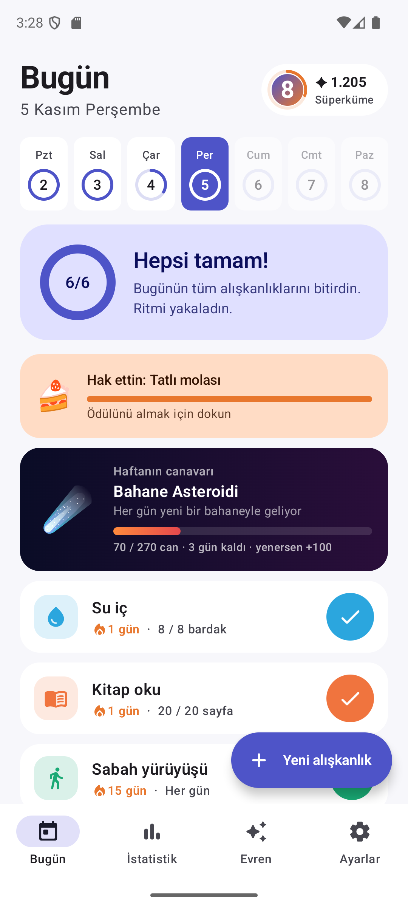
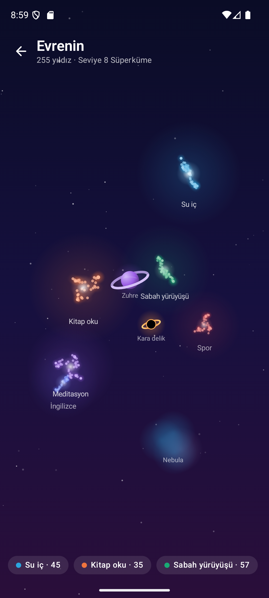
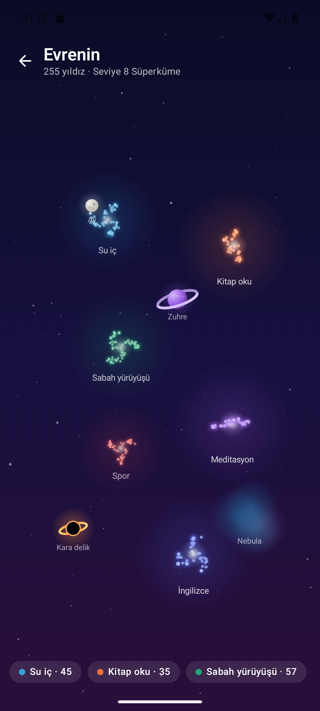
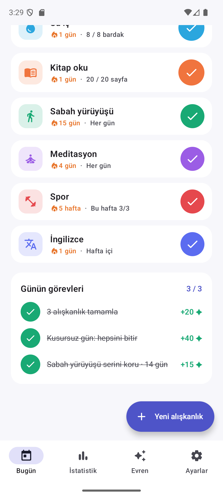
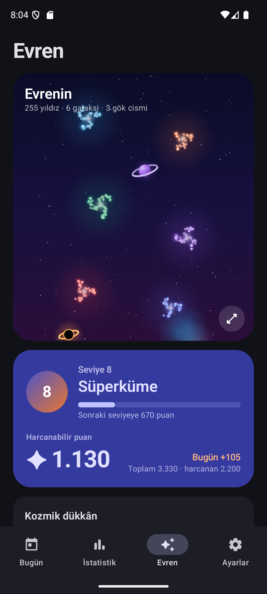
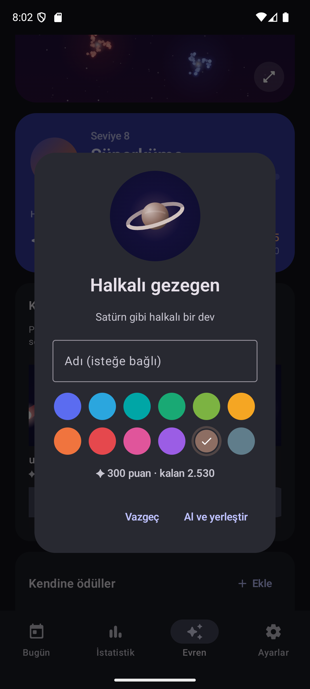
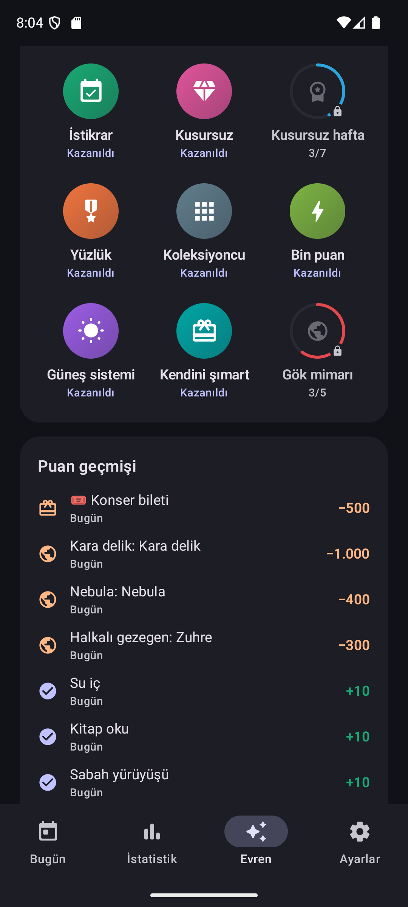
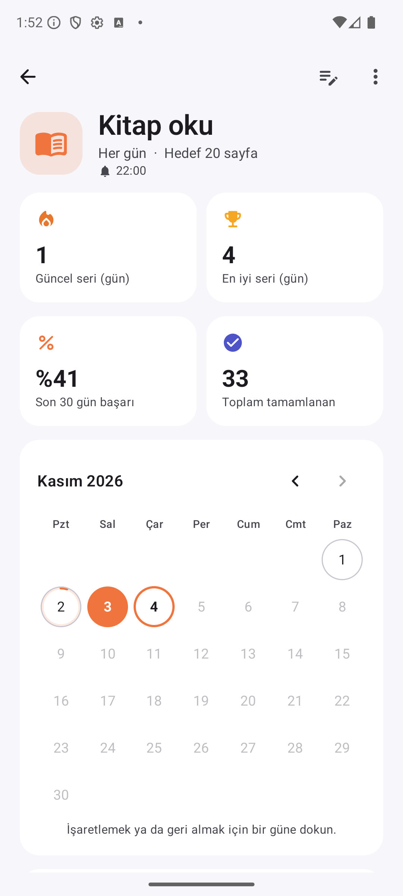

# Ritim — Alışkanlık Takibi

Kotlin + Jetpack Compose (Material 3) ile yazılmış, tamamen çevrimdışı çalışan Android alışkanlık takip uygulaması.
Her alışkanlık bir galaksidir: tamamladığın her gün o galaksiye bir yıldız ekler, kazandığın puanlarla evrenine
gezegenler ve nebulalar yerleştirir ya da kendine koyduğun gerçek ödülleri alırsın.

<p>
   
</p>
<p>
   
</p>

## Özellikler

### Takip
- **Esnek sıklık:** her gün, belirli günler (ör. Pzt/Çar/Cum) ya da haftada X kez
- **İki hedef türü:** tek dokunuşla tamamlanan ya da sayılı hedef (8 bardak su, 20 sayfa)
- **Seriler:** güncel ve en iyi seri; bugün henüz yapılmadıysa seri bozulmaz, plan dışı günler seriyi kesmez, haftalık hedeflerde seri hafta sayar
- **Bugün ekranı:** gün ilerleme halkası, haftalık şerit, geçmiş günü seçip düzeltme
- **Detay:** aylık takvimden geçmişe dönük işaretleme, son 20 haftanın ısı haritası, başarı oranı
- **İstatistikler:** 7/30/90 günlük tamamlama grafiği, alışkanlık sıralaması, haftanın günlerine dağılım
- **Hatırlatmalar:** alışkanlık başına saat; o gün yapılmadıysa bildirim, bildirimden tek dokunuşla tamamla / +1

### Oyun
- **Haftanın canavarı:** her hafta bir kötü alışkanlık boss olarak gelir (Erteleme Canavarı, Bahane Asteroidi, Ekran Hayaleti…). Canı o haftanın beklenen puanının dörtte üçü; her tamamlama alışkanlığın puanı kadar vurur, zor alışkanlık daha sert vurur. Pazar'a kadar yenersen +100
- **Günün görevleri:** alışkanlıklarından her gün üç görev üretilir: "3 alışkanlık tamamla", "Zor olanı hallet", "Su iç hedefini doldur", "Kusursuz gün", "Serini koru", "Geri dön"… Gün içinde değişmez, her gün farklıdır
- Görev ve canavar ödülleri oyunun açıldığı günden itibaren sayılır; eski kayıtlar geriye dönük ödül yağdırmaz

### Evren ve ödüller
- **3B gökyüzü:** galaksiler farklı derinliklerde, kendi açılarıyla eğik diskler; uzaktakiler sisli. Kart kendiliğinden salınır, tam ekranda sürükleyerek döndür, iki parmakla yakınlaştır
- **Galaksiler:** her alışkanlık gökyüzünde kendi renginde bir galaksi; her tamamlanan gün sarmal kollara bir yıldız ekler. Son haftanın yıldızları titrer, süren seri takımyıldız çizgileriyle bağlanır, arşivdeki alışkanlıkların galaksisi sönük kalır
- **Puan:** alışkanlığın zorluğuna göre tamamlama başına 5 / 10 / 20 puan; 7 günlük seride ×3 bonus, haftalık hedefte ×2, günün tamamı bitince +25 "kusursuz gün"
- **Kozmik dükkân:** puanla ay, gezegen, kuyruklu yıldız, halkalı gezegen, nebula, kara delik; rengini ve adını seç, gökyüzünde istediğin yere dokunarak yerleştir, sonra taşı ya da kaldır (puan iade)
- **Kendine ödüller:** gerçek hayat ödüllerini kendin tanımla (emoji, ad, bedel, tekrar alınabilir mi); birini hedef seç, Bugün ekranında ne kadar kaldığını gör
- **Seviyeler:** Toz bulutu → Kıvılcım → Yıldız → … → Evren; harcamak seviyeyi düşürmez
- **14 rozet** (seri, kusursuz hafta, yüzlük, gök mimarı, ilk zafer, görev ustası…) ve ayrıntılı puan geçmişi
- **Kutlamalar:** kazanılan puan rozeti, kusursuz günde ve ödül alınca konfeti, seviye atlama penceresi; ayarlardan kapatılabilir

### Diğer
- Arşiv, silme (geri al ile), tüm veriyi kapsayan JSON yedekleme / geri yükleme
- Açık / koyu / sistem teması, Pazartesi ya da Pazar hafta başlangıcı, açılış ekranı

## Puanlar neden saklanmıyor?

Puanlar, seviye, rozetler ve gökyüzündeki yıldızlar her seferinde kayıtlardan yeniden hesaplanır; yalnız harcamalar
(alınan ödüller, gök cisimleri) saklanır. Böylece bir işaret geri alınınca puanı ve yıldızı da geri gider, aç-kapa ile
puan kasılamaz, geçmişe dönük düzeltmeler her yerde tutarlı kalır. Yıldız konumları yalnız alışkanlığın kimliğine ve
yıldızın sırasına bağlıdır: yeni yıldız eklenince eskiler yerinden oynamaz.

## Mimari

```
domain/   Saf Kotlin: Habit, Schedule, HabitProgress (seri/oran), puan kuralları, seviye, rozetler, görevler, canavar, gökyüzü yerleşimi
data/     Room (habits, checks, rewards, redemptions, sky_objects; v1→v2→v3 göçleri), repository, JSON yedek, tercihler
notify/   AlarmManager tabanlı hatırlatmalar, bildirim eylemi ve açılışta yeniden kurma
ui/       Compose ekranları, ViewModel'ler, Canvas'ta perspektifle çizilen 3B gökyüzü ve gök cisimleri, kutlama katmanı
```

Seri, puan ve gökyüzü mantığı Android'e bağımlı değildir; birim testleri JVM'de koşar.

## Derleme

```bash
./gradlew testDebugUnitTest assembleDebug
```

- minSdk 26, targetSdk 35, AGP 8.9, Kotlin 2.1
- Release derlemesi R8 ile küçültülür (~1,5 MB)
