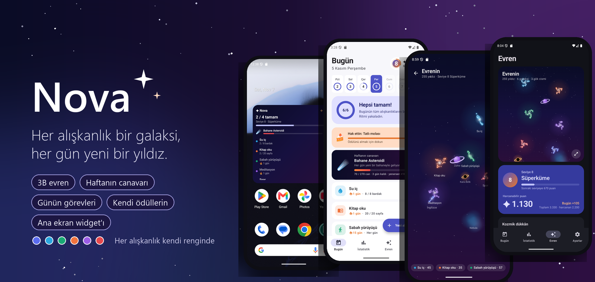
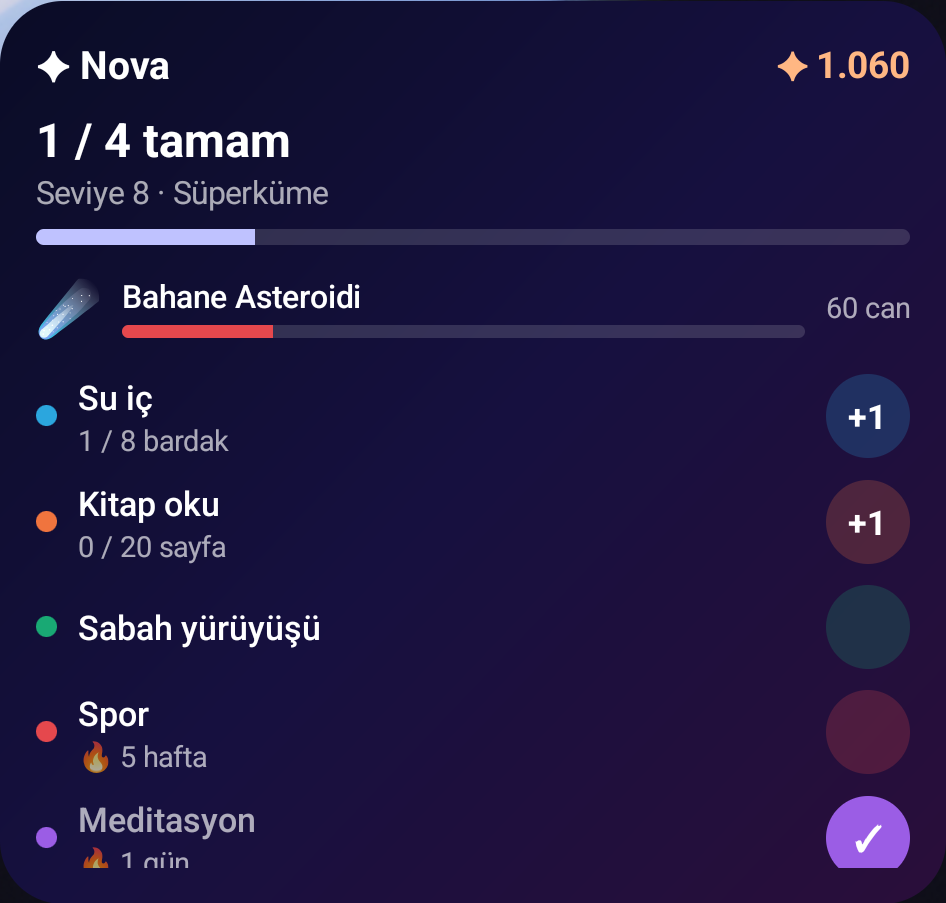
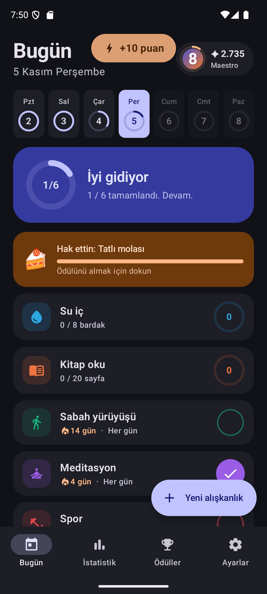
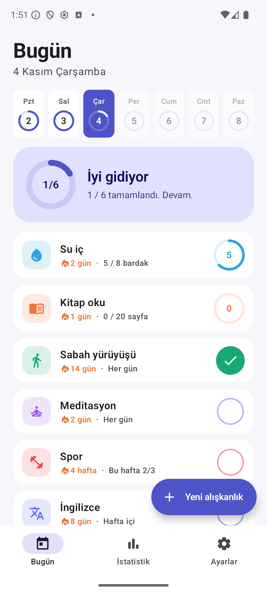
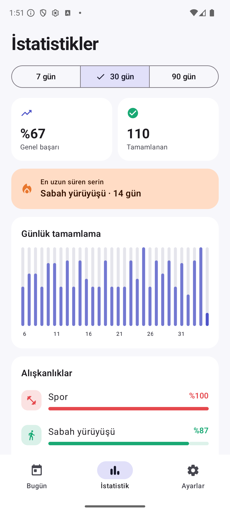
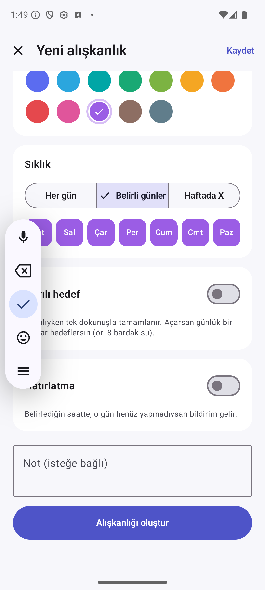

<p align="center">
  
</p>

<p align="center">
  <b>Alışkanlıklarını takip et, evrenini büyüt.</b><br/>
  Her alışkanlık gökyüzünde bir galaksi; tamamladığın her gün ona yeni bir yıldız ekler.<br/>
  Kazandığın puanlarla evrenine gezegenler kat, kendine koyduğun ödülleri al, haftanın canavarını alt et.
</p>

<p align="center">
  <a href="https://github.com/l4NGEL/nova/actions/workflows/ci.yml"></a>
  
  
  
  
  
  
</p>

<p align="center">
  <a href="#-evren">Evren</a> ·
  <a href="#-oyun">Oyun</a> ·
  <a href="#-ana-ekran-widgetı">Widget</a> ·
  <a href="#-ödüller-ve-seviyeler">Ödüller</a> ·
  <a href="#-takip">Takip</a> ·
  <a href="#-nasıl-çalışıyor">Nasıl çalışıyor</a> ·
  <a href="#-çalıştırma">Çalıştırma</a>
</p>

<br/>

<table>
  <tr>
    <td align="center" width="25%"><br/><sub><b>Bugün</b></sub></td>
    <td align="center" width="25%"><br/><sub><b>3B evren</b></sub></td>
    <td align="center" width="25%"><br/><sub><b>Kozmik dükkân</b></sub></td>
    <td align="center" width="25%"><br/><sub><b>Günün görevleri</b></sub></td>
  </tr>
</table>

## 🌌 Evren


Takip ettiğin her alışkanlık gökyüzünde kendi renginde bir galaksidir.

- **Her tamamlama bir yıldız.** Yıldızlar sarmal kollara dizilir; galaksi seninle birlikte büyür ve şekil alır.
- **Seri = takımyıldız.** Süren serinin yıldızları ince çizgilerle birbirine bağlanır. Son haftanın yıldızları titrer, bugünkü en parlak olanıdır.
- **Gerçek derinlik.** Galaksiler uzayda farklı uzaklıklarda, kendi açılarıyla eğik diskler; uzaktakiler sislenir. Kart kendi kendine salınır, tam ekranda sürükleyerek döndürür, iki parmakla yakınlaştırırsın.
- **Hiçbir şey kaybolmaz.** Arşivlediğin alışkanlığın galaksisi sönük de olsa yerinde kalır.

Bu sayfadaki her şey cihazda, Canvas üzerinde perspektifle çizilir; görsel ya da 3B motoru yoktur.

<br clear="right"/>

## 🐉 Oyun


**Haftanın canavarı.** Her hafta kötü alışkanlıklardan biri karşına çıkar: Erteleme Canavarı 🐙, Bahane Asteroidi ☄️, Uyuşukluk Ejderhası 🐉, Dağınıklık Kasırgası 🌪️, Ekran Hayaleti 👻, Tembellik Golemi 🗿.

- Canı o hafta beklenen puanlarının dörtte üçü: her şeyi yapman gerekmez, çoğunu yapman gerekir.
- Tamamladığın her alışkanlık zorluğu kadar vurur. Canavar sarsılır, hasar üstünden süzülür.
- Pazar'a kadar yenersen +100 puan ve konfeti.

**Günün görevleri.** Her sabah senin alışkanlıklarından üç görev çıkar: "3 alışkanlık tamamla", "Zor olanı hallet: Spor", "Su iç hedefini doldur", "Kusursuz gün", "Serini koru", "Geri dön: İngilizce"… Görevler gün içinde değişmez, her gün farklı gelir.

<br clear="right"/>

## 📱 Ana ekran widget'ı



Nova'yı açmadan da evrenine yıldız ekle.

- **Bugünün alışkanlıkları** sırayla listelenir; düğmeye dokununca tamamlanır, sayılı hedeflerde +1 eklenir.
- Gün ilerlemesi, harcanabilir puan ve seviye en üstte; büyük boyutta **haftanın canavarı** ve kalan canı da görünür.
- Boyutu serbest: küçükken yalnız özet, genişleyince liste, uzayınca canavar.
- Uygulamada, bildirimde ya da widget'ta ne değişirse diğerleri de hemen güncellenir; gün dönünce kendiliğinden yenilenir.

Jetpack Glance ile yazıldı.

<br clear="right"/>

## 🎁 Ödüller ve seviyeler

<table>
  <tr>
    <td align="center" width="33%"><br/><sub><b>Seviye ve bakiye</b></sub></td>
    <td align="center" width="33%"><br/><sub><b>Rozetler ve puan geçmişi</b></sub></td>
    <td align="center" width="33%"><br/><sub><b>Kazanılan puan</b></sub></td>
  </tr>
</table>

- **Puan:** alışkanlığın zorluğuna göre tamamlama başına 5 / 10 / 20. Yedi günlük seride ×3, haftalık hedefte ×2, günün tamamı bitince +25.
- **Kozmik dükkân:** ay, gezegen, kuyruklu yıldız, halkalı gezegen, nebula, kara delik. Rengini ve adını seç, gökyüzünde istediğin yere dokunarak yerleştir; sonra taşı ya da kaldır (puan iade edilir).
- **Kendine ödüller:** gerçek hayattaki ödüllerini sen tanımlarsın: "Bir bölüm dizi 🎬 50", "Konser bileti 🎟️ 500". Birini hedef seçersin, Bugün ekranında ne kadar kaldığını görürsün.
- **Seviyeler:** Toz bulutu → Kıvılcım → Yıldız → Takımyıldız → Güneş sistemi → Nebula → Galaksi → Süperküme → Kozmos → Evren. Puan harcamak seviyeyi düşürmez.
- **14 rozet:** Bir hafta, Ay boyu, Kusursuz hafta, Yüzlük, Gök mimarı, İlk zafer, Görev ustası…
- **Kutlamalar:** kazanılan puan rozeti, kusursuz günde ve ödül alınca konfeti, seviye atlama penceresi. İstersen ayarlardan kapatırsın.

## ✅ Takip

<table>
  <tr>
    <td align="center" width="25%"><br/><sub><b>Haftalık şerit</b></sub></td>
    <td align="center" width="25%"><br/><sub><b>Takvim ve ısı haritası</b></sub></td>
    <td align="center" width="25%"><br/><sub><b>İstatistikler</b></sub></td>
    <td align="center" width="25%"><br/><sub><b>Alışkanlık formu</b></sub></td>
  </tr>
</table>

- **Esnek sıklık:** her gün, belirli günler (Pzt/Çar/Cum) ya da haftada X kez.
- **İki hedef türü:** tek dokunuşla tamamlanan ya da sayılı hedef (8 bardak su, 20 sayfa). Dokununca +1, basılı tutunca değer girersin.
- **Adil seriler:** bugün henüz yapmadıysan seri bozulmaz, plan dışı günler seriyi kesmez, haftalık hedeflerde seri hafta sayar.
- **Geçmişi düzelt:** haftalık şeritten ya da aylık takvimden geçmiş bir günü seçip işaretle.
- **İstatistikler:** 7 / 30 / 90 günlük tamamlama grafiği, alışkanlık sıralaması, haftanın en verimli günü, son 20 haftanın ısı haritası.
- **Hatırlatmalar:** alışkanlık başına saat. O gün yapılmadıysa bildirim gelir; bildirimden "Tamamlandı" ya da "+1" dersin. Cihaz yeniden başlayınca kendiliğinden kurulur.
- **Diğerleri:** arşiv, geri alınabilir silme, tek dosyada JSON yedek, açık / koyu / sistem teması, Pazartesi ya da Pazar hafta başlangıcı.

## 🔭 Nasıl çalışıyor

**Puan saklanmaz, hesaplanır.** Puanlar, seviye, rozetler, görevler, canavarın canı ve gökyüzündeki yıldızlar her seferinde günlük kayıtlardan yeniden türetilir; yalnız harcamalar (alınan ödüller, gök cisimleri) saklanır. Bir işareti geri alınca puanı da yıldızı da geri gider: aç-kapa ile puan kasılamaz, geçmişe dönük düzeltmeler her yerde tutarlı kalır. Görev ve canavar ödülleri oyunun ilk açıldığı günden itibaren sayılır ki eski kayıtlar geriye dönük ödül yağdırmasın.

**Yıldızlar yerinden oynamaz.** Bir yıldızın konumu yalnız alışkanlığın kimliğine ve yıldızın sırasına bağlıdır: yeni yıldız eklenince eskileri kaymaz, yeni alışkanlık eklenince var olan galaksiler taşınmaz. Galaksinin eğimi ve derinliği de kimlikten gelir; evrenin her açılışta aynıdır.

```
domain/   Saf Kotlin: alışkanlık ve takvim, seri ve oran, puan kuralları, seviye,
          rozetler, görevler, haftanın canavarı, gökyüzü yerleşimi
data/     Room (habits, checks, rewards, redemptions, sky_objects; v1→v2→v3 göçleri),
          repository, JSON yedek, tercihler
notify/   AlarmManager hatırlatmaları, bildirim eylemi, açılışta yeniden kurma
widget/   Glance ana ekran widget'ı ve widget'tan işaretleme
ui/       Compose ekranları ve ViewModel'ler, perspektifle çizilen 3B gökyüzü,
          gök cisimleri, kutlama katmanı
```

Seri, puan, görev, canavar ve gökyüzü mantığı Android'e bağımlı değildir; 49 birim testi JVM'de koşar.

## 🚀 Çalıştırma

```bash
./gradlew testDebugUnitTest assembleDebug
```

APK: `app/build/outputs/apk/debug/app-debug.apk`. Her push'ta GitHub Actions testleri koşar ve APK'yı derler.

- minSdk 26 (Android 8.0), targetSdk 35, AGP 8.9, Kotlin 2.1
- Release derlemesi R8 ile küçültülür: ~1,5 MB
- İnternet izni yoktur; veri telefondan çıkmaz.
